# PEMFC ModelLab v0.3.1 — Gestión de dispositivos e identificación (Motor 1) + digitalizador inteligente

Página principal con acceso al **Motor 1** y al **Motor 2** (en construcción) y pestaña «Modelo implementado» con las ecuaciones reales del código.

Plataforma Streamlit para **incorporar, caracterizar, calibrar y administrar dispositivos PEMFC** y generar perfiles
electroquímicos reproducibles, más un **digitalizador científico** que convierte figuras en tablas X–Y.

> **Alcance.** Solo Motor 1 (identificación paramétrica); el Motor 2 (simulación operacional, H₂, costes) no está
> implementado. La curva V–I es obligatoria. Un buen ajuste no es una validación experimental independiente.
> Nunca se inventan valores de ejes, unidades, N_cells, A_active ni σ_V.

**Dos flujos integrados visualmente y desacoplados en su lógica científica:**

1. **Motor 1:**
   - catálogo de dispositivos → crear un dispositivo;
   - flujo guiado de 01 Dispositivo a 06 Perfil y exportación;
   - historial de calibraciones, perfil activo y comparación.
2. **Digitalizador:**
   - cargar una figura → reconocimiento automático de paneles, ejes, números (OCR local verificado geométricamente), unidades y curvas;
   - corregir si hace falta;
   - exportar CSV, XLSX, JSON, PNG o ZIP sin pasar por el Motor 1.

**Persistencia:**
- **Automática:** se guarda en el navegador (IndexedDB) y sobrevive a recargas.
- **Proyecto portátil `.pmlproj.zip`:** permite conservar el trabajo con independencia del navegador.
- **Sin cuentas ni servicios externos.** Las garantías reales están en `docs/ARQUITECTURA_v0.3.0.md` §3.

**Documentación:**
- `docs/GUIA_USUARIO.md`: guía de usuario.
- `docs/ARQUITECTURA_v0.3.0.md`: arquitectura, persistencia, OCR, calibración geométrica, exportaciones y compatibilidad.
- `docs/VERIFICACION_v0.3.0.md`: verificación y limitaciones.
- `CHANGELOG.md`: cambios por versión.

| | |
|---|---|
| 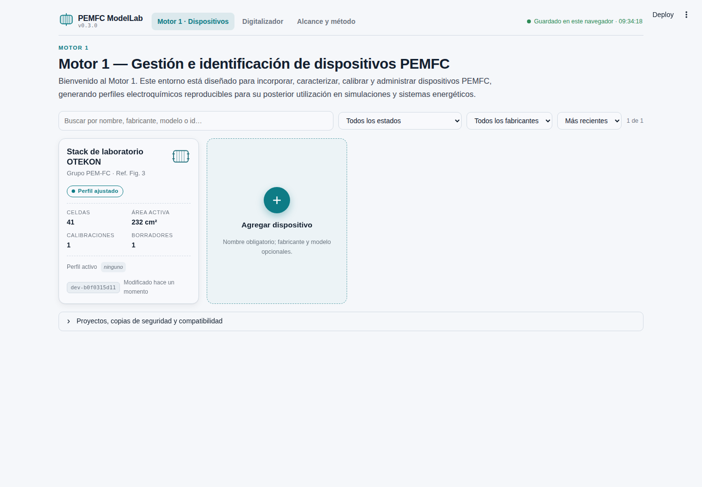 | 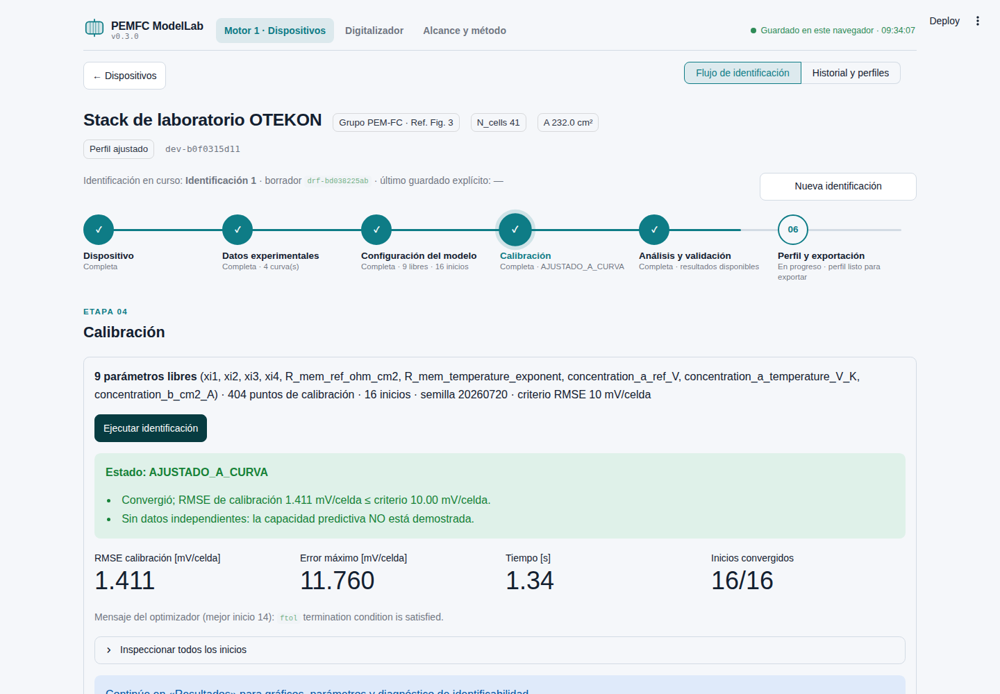 |
| 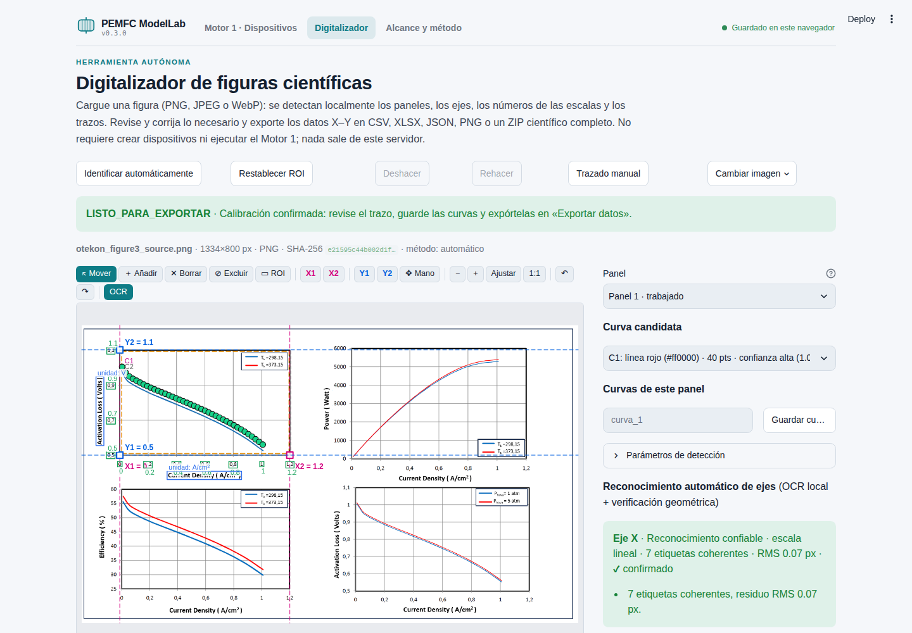 | 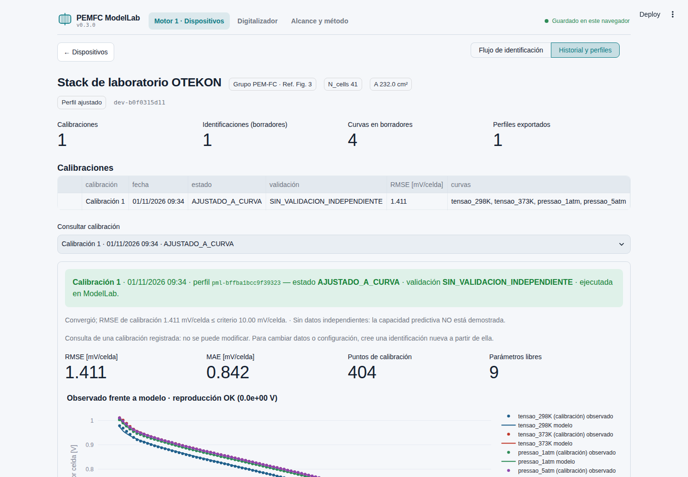 |

## Uso local

Requiere Python 3.11 o superior (verificado con 3.12.3).

```bash
python -m venv .venv
source .venv/bin/activate          # Windows: .venv\Scripts\activate
pip install -r requirements.txt
streamlit run app.py
```

Flujo: **1. Importar curva** (dispositivo, CSV, datos pegados o **imagen de una curva**, mapeo de columnas y unidades, condiciones,
revisión de puntos) → **2. Configurar identificación** (parámetros libres/fijos, límites, priors, multistart) →
**3. Calibrar** → **4. Resultados** (polarización, residuos, pérdidas, parámetros, identificabilidad,
validación) → **5. Exportar perfil** (JSON, ZIP; reimportar y verificar un perfil existente).

Para probar sin datos propios, use «Ejemplos documentados» en la primera pestaña: OTEKON Fig. 3 (4 curvas),
stack de 65 kW (Chen et al. 2024), muestra ilustrativa del handoff y un caso sintético.

### Formato CSV

Una fila de encabezado y, como mínimo, una columna de corriente y una de tensión. Separador `,`, `;` o
tabulador; decimal `.` o `,`. Líneas que empiezan con `#` se ignoran. Una columna opcional puede identificar
varias curvas en el mismo archivo. Unidades soportadas: A, mA, A/cm², mA/cm², A/m²; V o mV, por celda o de
stack. La temperatura y la presión de cada curva se introducen en la interfaz (obligatorias).

```csv
corriente_A;tension_stack_V
2.5;18.40
5;17.60
10;16.90
```

### Digitalizar una curva desde una imagen (v0.2.0)

**1. Importar curva → Imagen de una curva → Abrir digitalizador.** Suba un PNG, JPEG o WebP, o use una imagen de
ejemplo.

1. La detección local de ejes, ticks y trazo se ejecuta al cargar y dibuja los puntos sobre la imagen.
2. Escriba los valores de las cuatro referencias X1, X2, Y1 e Y2, propuestas sobre los ticks detectados. Revise
   las unidades.
3. Corrija el trazo con los modos del lienzo (mover, añadir, borrar, excluir, ROI, zoom, desplazar, deshacer) o en
   la tabla sincronizada.
4. Complete temperatura y presión y pulse **Confirmar y añadir curva**.

La imagen original, el JSON de auditoría, el CSV y el overlay se incluyen en el ZIP del experimento. Detalles,
algoritmo y limitaciones en `docs/DIGITALIZADOR.md`; verificación en `docs/VERIFICACION_DIGITALIZADOR.md`.

## Pruebas

```bash
pip install -r requirements-dev.txt
python -m pytest -q                      # 200 pruebas (núcleo, digitalizador, OCR, espacio de trabajo, AppTest)
python tools/reproduce_otekon.py         # baseline OTEKON (RMSE 0,001411370003309 V/celda)
python tools/evaluate_digitizer.py       # exactitud del digitalizador frente a los truth sintéticos y la figura OTEKON
```

Las pruebas en navegador real (Playwright) están en `tools/e2e/`: `e2e_v030_*.py` para v0.3.0 y el resto para el
digitalizador de v0.2.0 (ver su README). Resultados de la última ejecución:
`docs/VERIFICACION.md` (v0.1.0) y `docs/VERIFICACION_DIGITALIZADOR.md` (v0.2.0).

## Despliegue en Streamlit Community Cloud

1. Cree un repositorio en GitHub y suba el contenido de esta carpeta (incluidos `examples/`, `tests/fixtures/` y
   `.streamlit/config.toml`). No hay secretos ni servicios externos.
2. En <https://share.streamlit.io> elija **Create app → Deploy a public app from GitHub**, seleccione el
   repositorio y la rama, y como archivo principal `app.py`.
3. En **Advanced settings**, elija Python 3.12 (versión verificada). Streamlit Cloud instala `requirements.txt`.
4. Despliegue. La app no escribe en el servidor: los perfiles se descargan y se vuelven a cargar. Las imágenes del
   digitalizador se procesan en memoria en el propio servidor de la app; no se envían a terceros.

El lienzo del digitalizador es un componente `st.components.v2` con JavaScript y CSS locales
(`ui/static/`), sin paso de compilación: no hay `npm install` ni artefactos que construir. `opencv-python-headless`
no requiere paquetes del sistema (no hace falta `packages.txt`).

```bash
git init && git add . && git commit -m "PEMFC ModelLab — Hito 1"
git branch -M main
git remote add origin https://github.com/<organizacion>/PEMFC-ModelLab.git
git push -u origin main
```

## Estructura

```
app.py                     Entrada Streamlit (pestañas)
pemfc_core/                Núcleo físico sin Streamlit: model, parameters, units, schemas
identification/            Datos, optimizador, diagnósticos, perfiles, reporte, ejemplos
digitizer/                 Digitalizador sin Streamlit: imagen, detección, calibración, borrador, confirmación
ui/                        Vistas Streamlit (solo presentación y estado); ui/static/ = lienzo JS/CSS local
examples/                  Datos de ejemplo con procedencia
tests/                     pytest (+ fixtures generados con el código original)
tools/                     Fixtures, reproducción OTEKON, evaluación del digitalizador, e2e/ (Playwright)
docs/                      Auditoría, plan, metodología, contrato de perfil, verificación
```

## Procedencia, licencia y atribución

Modelo e identificador derivados de [PEM-FC](https://github.com/brunoolmedo22-Paraguay/PEM-FC) (commit
a533432), reconstrucción del modelo de Altıntaş & Ertan (OTEKON 2024). Concepto de perfil y datos del stack de
65 kW de [EnergyMultimodelv1.5](https://github.com/brunoolmedo22-Paraguay/EnergyMultimodelv1.5) (commit 761f032);
fuente experimental: Chen, H. et al., CIESC Journal 75(2), 637–646, 2024, DOI 10.11949/0438-1157.20230745.

Los repositorios de origen no declaran licencia. **La licencia y la titularidad de este proyecto deben ser
definidas por el equipo antes de publicarlo**; no se incluye archivo LICENSE para no presuponerlas.

## Capturas

Flujo verificado en navegador real (Chromium headless) contra `streamlit run app.py`.
Digitalizador (v0.2.0):

| | |
|---|---|
| 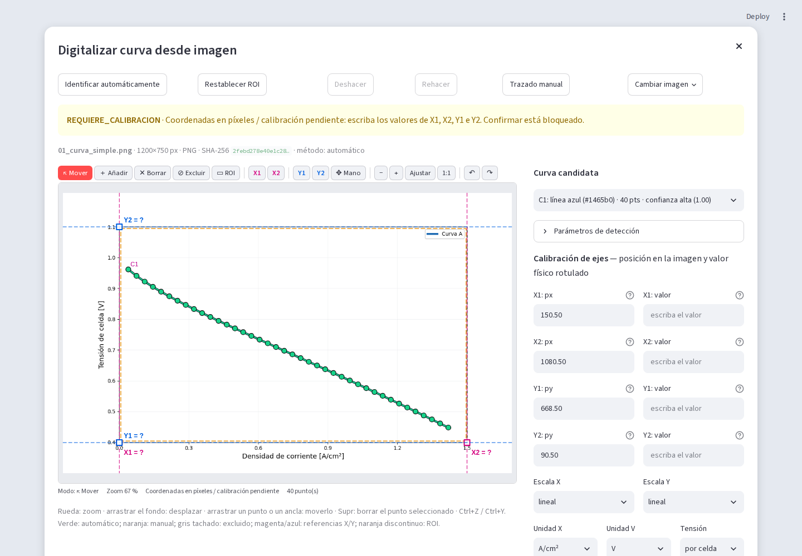 | 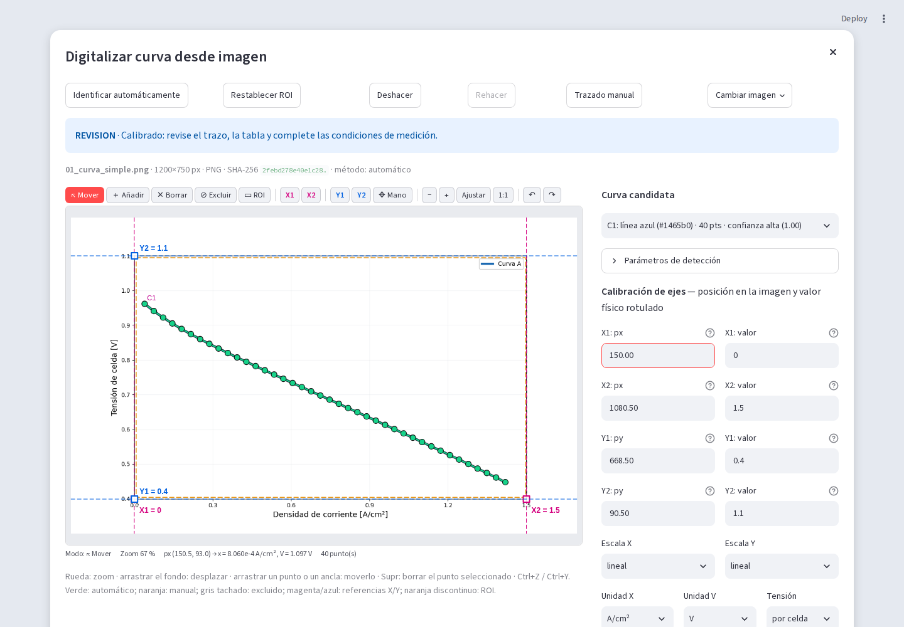 |
| 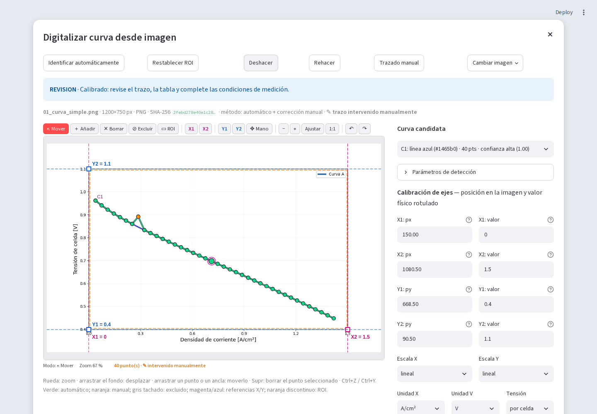 | 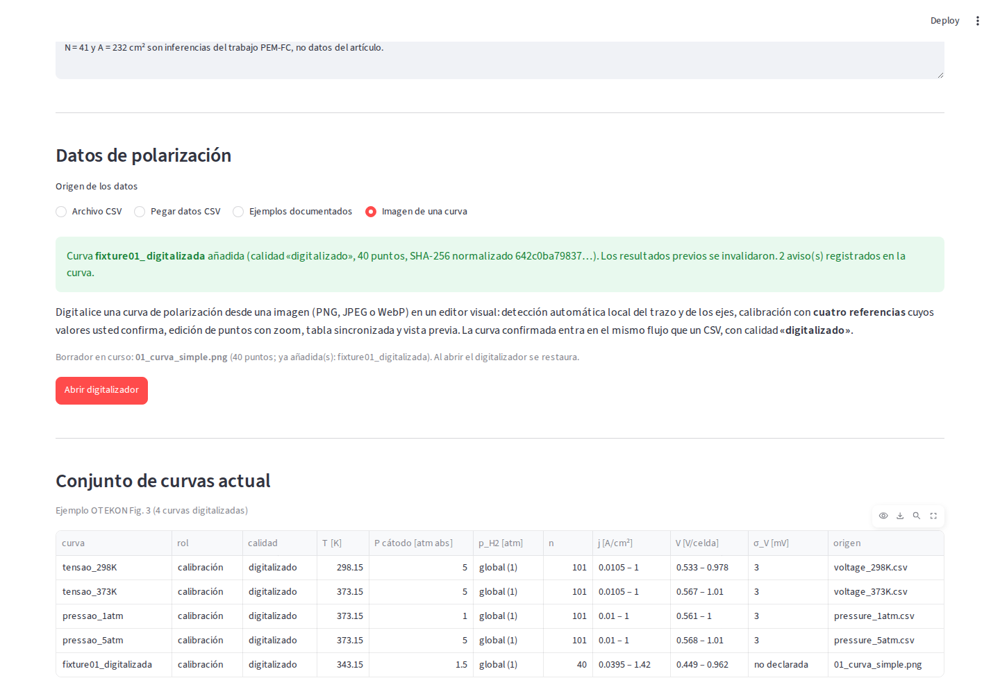 |

Motor 1 (v0.1.0):

| | |
|---|---|
| 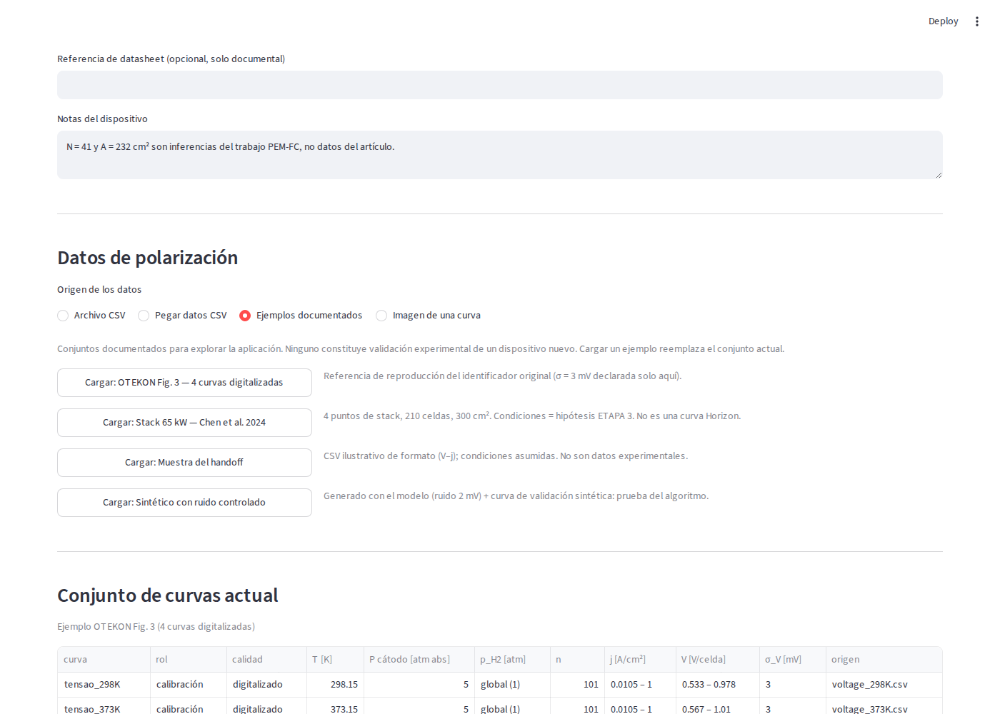 | 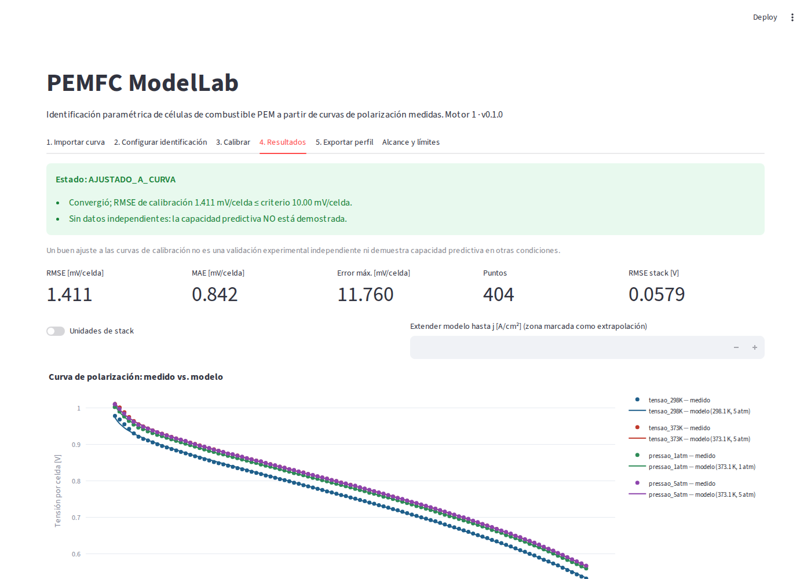 |
| 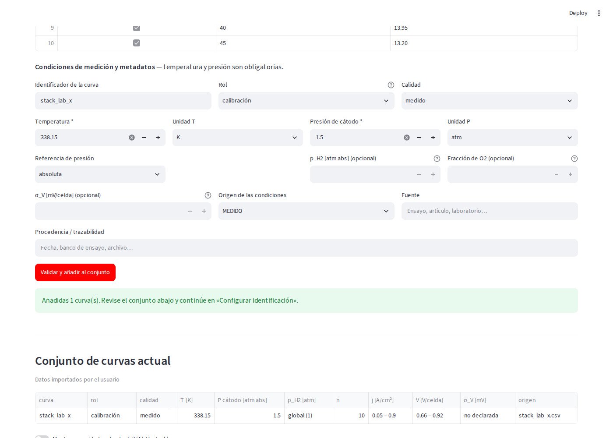 | 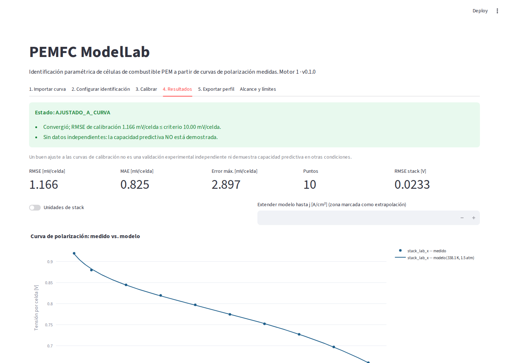 |
